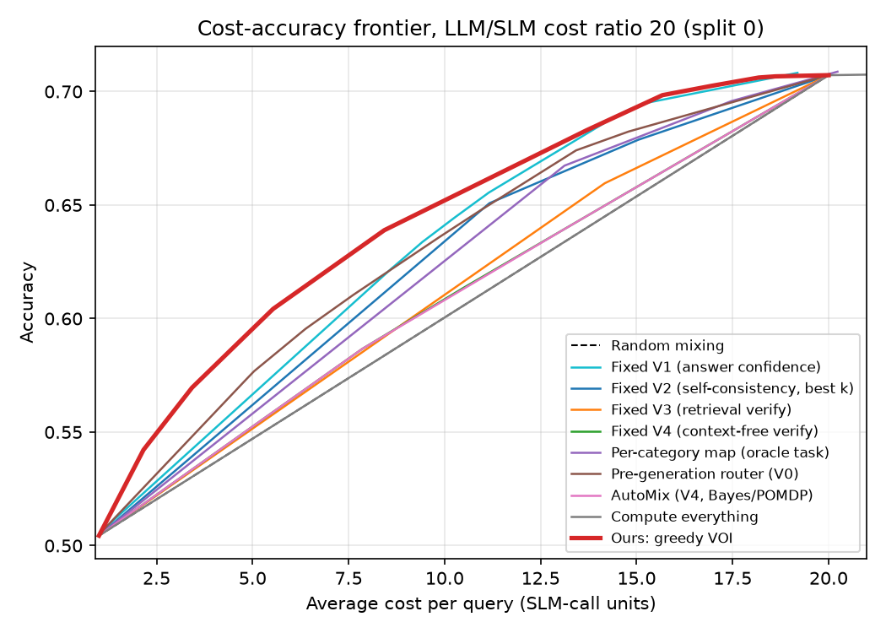
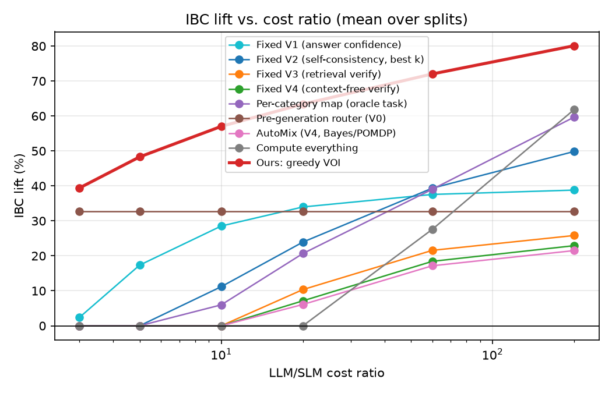
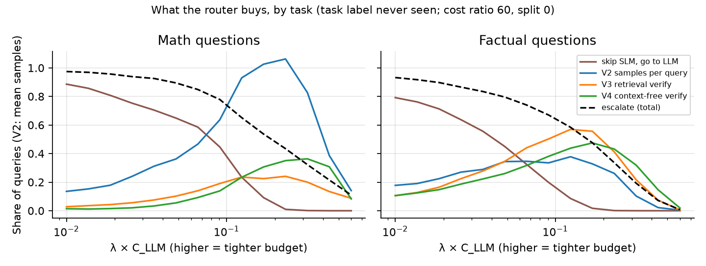
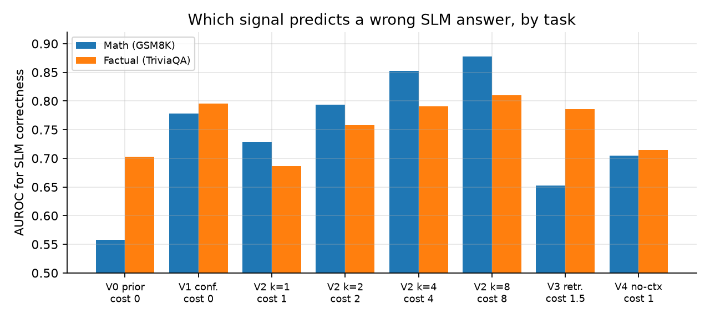
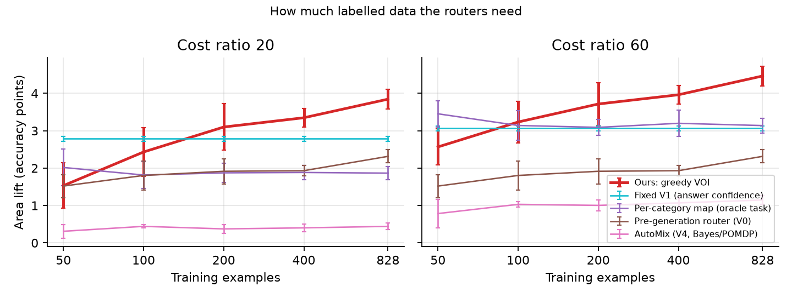
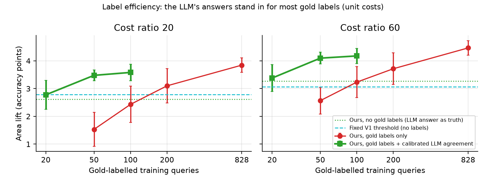
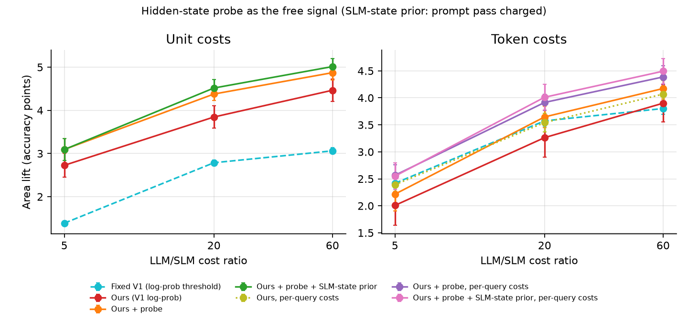

# Choosing What to Verify in Context-Free LLM Cascades

*Semester project report: an extension of AutoMix (Aggarwal et al., NeurIPS 2024). Experiments run 24–25 October 2026.*

## Abstract

AutoMix routes queries from a small language model (SLM) to a large one (LLM) using the
SLM's self-verification against a context passage. Real assistant traffic usually has no such
passage. We study cascades for **context-free** questions, where a router must decide, per
query and under a cost budget, which verification signal to pay for before accepting the
SLM's answer or escalating. We formulate this as value-of-information (VOI) acquisition over
a belief about the query's latent type, with five signals: a query-only prior (V0), the SLM's
answer confidence (V1), self-consistency samples (V2), retrieval-grounded verification (V3)
and AutoMix-style context-free verification (V4).

On 2,761 GSM8K and TriviaQA questions with Qwen2.5-1.5B as the SLM and Qwen2.5-7B as the
LLM, the greedy VOI router beats every baseline at every LLM/SLM cost ratio from 3 to 200
under unit costs (paired bootstrap, p < 0.001 against every baseline except a tie with the
pre-generation router at ratio 3). That includes AutoMix, fixed verifiers, a per-category
verifier map that is given the true task label, and a pre-generation router. Its IBC lift is
39–80% against AutoMix's 0–22%.

Ablations qualify the story. Most of the gain comes from combining the two *free* signals
(V0 and V1) in a calibrated belief. Buying self-consistency adds 0.4–0.8 accuracy points at
high cost ratios. Choosing among heterogeneous verifiers (V3, V4) adds nothing measurable
beyond V2, even though the router learns to buy retrieval verification mostly for factual
questions. Exact POMDP planning matches the greedy rule. Under token-proportional costs the
router ties a simple answer-confidence threshold at low cost ratios. With a different SLM that
is nearly useless at math, a pre-generation router is as good as ours.

Two follow-ups address the weaknesses this exposed (§4.6).

- **Fewer gold labels.** Training on "does the SLM agree with the LLM?" fails on its own: it
  cannot recognise questions neither model can answer. Calibrated with 50 gold labels,
  though, it beats training on 200 gold labels and beats the threshold in every split.
- **A better free signal.** A linear probe on the SLM's hidden states predicts its correctness
  with AUROC 0.82–0.84, against 0.78–0.80 for token log-probability. It adds 0.4–0.5
  accuracy points under unit costs, and it turns the token-cost tie into a win at cost
  ratios 20 and 60.

## 1. Problem

AutoMix (Aggarwal et al., 2024) showed that a small model can check its own answer by asking
whether the answer is *entailed by a given context*, and that a POMDP router can turn this
noisy signal into good routing decisions. Its authors list factual QA and commonsense
reasoning as out of scope, because there is no context to check against. Chat assistants mostly
see exactly those questions.

Research question: **with no context passage, can a router that chooses which verification
signal to buy, per query and under a budget, beat cascades that use any single fixed verifier?**

## 2. Method

**Latent types.** Each query has a hidden type z determined by which models answer it
correctly: *easy* (both), *hard* (LLM only), *unsolvable* (neither), *SLM-only*. Accepting
the SLM is worth P(easy) + P(SLM-only); escalating is worth P(easy) + P(hard) − λ·C_LLM,
where λ converts cost into accuracy and is swept to trace a cost–accuracy curve.

**Signals.**

| ID | Signal | Cost (SLM-call units) |
| --- | --- | --- |
| V0 | Query-only prior: bge-small embedding → multinomial logistic regression over z | 0 |
| V1 | Mean token log-probability of the SLM's greedy answer | 0 (free with generation) |
| V2 | Agreement of temperature-0.7 samples with the greedy answer, drawn one at a time | 1 per sample |
| V3 | Retrieve 3 Wikipedia intro passages for question + answer, then AutoMix's entailment prompt over them (4 votes) | 1.5 |
| V4 | AutoMix's verification prompt with no context (4 votes) | 1 |

**Calibration.** Each signal gets an observation model P(o | z, g) fitted on the training
split: quantile-binned tables for V1, vote-count tables for V3/V4 and a beta-binomial model for
V2 (so samples can be observed one by one), where g is a k-means cluster of the query embedding.
Signals combine naive-Bayes style. Every signal therefore moves the same belief over z.

**Greedy VOI router.** Before generating, the router may escalate directly if that beats
generating and then acting. After generating (V1 arrives free), it repeatedly buys the signal
whose expected improvement in the final decision most exceeds λ × its cost, with V2 lookahead
over batches of 1, 2, 4 and 8 samples. It stops when nothing is worth buying, then accepts or
escalates.

**Exact planner.** A finite-horizon POMDP over the same states and actions, solved exactly by
expectimax (at most 4 V2 samples plus V3 and V4), used to test whether non-myopic planning helps.

## 3. Setup

- **Data:** all 1,319 GSM8K test questions and 1,442 unique TriviaQA (rc.nocontext, validation)
  questions, shuffled into one stream. 1,500 were sampled; 58 were duplicate question IDs.
  Routers never see the task label, except the oracle per-category baseline.
- **Models:** SLM Qwen2.5-1.5B-Instruct and LLM Qwen2.5-7B-Instruct-AWQ, both served with vLLM on
  a Kaggle T4. One generic prompt is used for every query. Robustness: SmolLM2-1.7B-Instruct as SLM.
- **Accuracy:** SLM 0.592 on math and 0.398 on factual; LLM 0.894 and 0.537. 40% of factual
  questions are unsolvable by both models (578 of 1,442).
- **Protocol:** 5 random splits, 30% train and 70% test. Every method is fitted on the train split only.
- **Cost:** unit costs with the LLM costing r ∈ {3, 5, 10, 20, 60, 200} SLM calls, plus a
  token-proportional variant.
- **Metrics:** each method's frontier is the upper convex hull of its operating points plus
  always-SLM and always-LLM, since randomising between operating points is always possible.
  **IBC lift** is AutoMix's metric averaged over the midpoints of five equal cost regions.
  **Area lift** is the mean accuracy gain over the random-mixing line, in points. 0 means no
  better than random mixing.
- **Baselines:**
  - always-SLM, always-LLM and random mixing
  - each fixed verifier with a threshold (V2 at its best sample count)
  - a per-category map given the true task (math → V2, factual → V3)
  - a pre-generation router using V0 only (HybridLLM/RouteLLM style)
  - AutoMix: one V4 observation and a Bayes decision. For two models AutoMix's POMDP reduces to this.
  - "compute everything", with naive Bayes or a learned combiner

## 4. Results

### 4.1 Main comparison (unit costs)

IBC lift (%), mean ± std over 5 splits:

| Method | r=3 | r=5 | r=10 | r=20 | r=60 | r=200 |
| --- | --- | --- | --- | --- | --- | --- |
| **Ours: greedy VOI** | **39.4 ± 4.5** | **48.3 ± 4.7** | **57.0 ± 3.7** | **63.4 ± 3.8** | **72.0 ± 4.6** | **80.1 ± 5.7** |
| Pre-generation router (V0) | 32.7 ± 3.4 | 32.7 ± 3.4 | 32.7 ± 3.4 | 32.7 ± 3.4 | 32.7 ± 3.4 | 32.7 ± 3.4 |
| Fixed V1 (answer confidence) | 2.4 ± 1.0 | 17.3 ± 0.9 | 28.5 ± 0.8 | 34.0 ± 0.8 | 37.6 ± 0.8 | 38.8 ± 0.8 |
| Fixed V2 (self-consistency, best k) | 0.0 | 0.0 | 11.2 ± 1.2 | 23.9 ± 1.5 | 39.4 ± 2.8 | 49.9 ± 2.9 |
| Fixed V3 (retrieval verify) | 0.0 | 0.0 | 0.0 | 10.4 ± 1.1 | 21.6 ± 1.7 | 25.8 ± 1.7 |
| Fixed V4 (context-free verify) | 0.0 | 0.0 | 0.0 | 7.1 ± 0.7 | 18.4 ± 0.9 | 22.9 ± 0.9 |
| Per-category map (oracle task) | 0.0 | 0.0 | 6.0 ± 2.2 | 20.7 ± 2.0 | 39.1 ± 5.7 | 59.7 ± 4.2 |
| AutoMix (V4, Bayes/POMDP) | 0.0 | 0.0 | 0.0 | 6.1 ± 1.0 | 17.2 ± 1.4 | 21.5 ± 1.5 |
| Compute everything | 0.0 | 0.0 | 0.0 | 0.0 | 27.6 ± 3.2 | 61.8 ± 5.1 |

Area lift (accuracy points over random mixing):

| Method | r=3 | r=5 | r=10 | r=20 | r=60 | r=200 |
| --- | --- | --- | --- | --- | --- | --- |
| **Ours: greedy VOI** | **2.37 ± 0.25** | **2.73 ± 0.28** | **3.32 ± 0.21** | **3.85 ± 0.26** | **4.47 ± 0.26** | **4.88 ± 0.26** |
| Pre-generation router (V0) | 2.32 ± 0.18 | 2.32 ± 0.18 | 2.32 ± 0.18 | 2.32 ± 0.18 | 2.32 ± 0.18 | 2.32 ± 0.18 |
| Fixed V1 (answer confidence) | 0.16 ± 0.08 | 1.39 ± 0.05 | 2.35 ± 0.06 | 2.79 ± 0.07 | 3.06 ± 0.07 | 3.15 ± 0.08 |
| Per-category map (oracle task) | 0.00 | 0.00 | 0.56 ± 0.20 | 1.87 ± 0.18 | 3.14 ± 0.20 | 4.02 ± 0.14 |
| AutoMix (V4, Bayes/POMDP) | 0.00 | 0.00 | 0.00 | 0.44 ± 0.09 | 1.15 ± 0.12 | 1.39 ± 0.13 |
| Compute everything | 0.00 | 0.00 | 0.00 | 0.00 | 2.40 ± 0.20 | 4.47 ± 0.23 |





**Significance.** We ran a paired bootstrap over test queries: 1,000 resamples per split,
averaged over 5 splits, recomputing every frontier. Ours beats every baseline on both metrics
at every ratio with p < 0.001. The one exception is the pre-generation router at ratio 3 on
area lift: difference 0.01 points, 95% CI [−0.15, 0.16], a tie. Full table:
`results/ablations/bootstrap.md`.

**Hypotheses from the proposal.**

| | Hypothesis | Result |
| --- | --- | --- |
| H1 | Beats every single fixed verifier | Supported at all ratios |
| H2 | Beats the per-category map even though it gets the true task label | Supported at all ratios, but see 4.3 for why |
| H3 | Advantage over AutoMix grows as the cost ratio shrinks | Supported: AutoMix gives no lift at r ≤ 10, ours gives 39–57% |
| H4 | At least matches the pre-generation router | Supported on average; tied at r = 3 |
| H5 | Exact planning adds little over greedy | Supported (4.4) |

### 4.2 What the router does

The router never sees the task label, yet it buys different signals for math and for factual
questions:
- At moderate budgets, math questions get self-consistency samples and factual questions get
  retrieval verification.
- At tight budgets it rarely escalates factual questions, because many of them neither model
  can answer.



### 4.3 Where the gain comes from (ablations)

Area lift, mean ± std over 5 splits:

| Router variant | r=5 | r=20 | r=60 |
| --- | --- | --- | --- |
| Full router | 2.73 ± 0.28 | 3.85 ± 0.26 | 4.47 ± 0.26 |
| − V1 (answer confidence) | 2.03 ± 0.16 | 2.82 ± 0.09 | 3.42 ± 0.19 |
| − V0 prior (base rates instead) | 1.39 ± 0.18 | 2.87 ± 0.12 | 3.61 ± 0.23 |
| − V2 (self-consistency) | 2.72 ± 0.25 | 3.62 ± 0.11 | 4.06 ± 0.13 |
| − V3 (retrieval verify) | 2.72 ± 0.29 | 3.86 ± 0.23 | 4.49 ± 0.20 |
| − V4 (context-free verify) | 2.78 ± 0.27 | 3.87 ± 0.27 | 4.46 ± 0.29 |
| − skip-the-SLM action | 2.31 ± 0.31 | 3.94 ± 0.23 | 4.58 ± 0.20 |
| − V2 batch lookahead (1 sample) | 2.73 ± 0.28 | 3.84 ± 0.24 | 4.38 ± 0.22 |
| − query groups (1 group) | 2.80 ± 0.27 | 3.98 ± 0.26 | 4.53 ± 0.28 |
| V1 as KDE instead of bins | 2.75 ± 0.29 | 3.92 ± 0.28 | 4.57 ± 0.33 |
| Free signals only (V0 + V1) | 2.77 ± 0.22 | 3.48 ± 0.18 | 3.69 ± 0.17 |
| Only paid verifier: V2 | 2.76 ± 0.27 | 3.85 ± 0.30 | 4.43 ± 0.27 |
| Compute everything, naive Bayes | 0.00 | 0.00 | 2.40 ± 0.20 |
| Compute everything, learned combiner | 0.00 | 0.00 | 2.29 ± 0.10 |

Reading this table:
1. **The free signals carry most of the gain.** Removing V1 or the V0 prior costs 0.7–1.3
   points. Using *only* V0 and V1 already beats every baseline at r = 5 and r = 20
   (2.77 vs 2.32 and 3.48 vs 2.79 for the best baseline).
2. **Self-consistency is the one paid signal that pays,** adding 0.4–0.8 points at r = 20–60.
3. **V3 and V4 add nothing measurable inside the router.** V3 is a good signal on its own
   for factual questions (AUROC 0.79, table below), but it overlaps with V1 (0.80, free).
   Choosing among verifier types, the proposal's central hypothesis, is learned (4.2) but
   does not translate into accuracy beyond V2.
4. **Skipping the SLM helps at low cost ratios** (+0.4 at r = 5) and is neutral at high ones.
   Query groups and V1's exact parametrisation do not matter.
5. **Paying for every signal on every query is wasteful.** It is never better than random
   mixing below r = 60, whether the signals are combined by naive Bayes or a learned model.

**Signal reliability**: AUROC for predicting a correct SLM answer.

| Signal | Cost | Math | Factual |
| --- | --- | --- | --- |
| V0 query-only prior (5-fold CV) | 0 | 0.558 | 0.703 |
| V1 answer confidence | 0 | 0.778 | 0.796 |
| V2 self-consistency, k = 1 / 2 / 4 / 8 | 1 / 2 / 4 / 8 | 0.729 / 0.793 / 0.852 / 0.878 | 0.686 / 0.757 / 0.790 / 0.810 |
| V3 retrieval verify | 1.5 | 0.652 | 0.786 |
| V4 context-free verify | 1 | 0.705 | 0.715 |



Signals are positively correlated within each type (V1–V2 Spearman 0.26–0.56, V3–V4 up to
0.48), so the naive-Bayes combination double-counts. A learned combiner did not do better
in the "compute everything" setting.

### 4.4 Exact planning vs. greedy (H5)

400-query test subsamples, 3 splits:

| Cost ratio | Exact (≤ 4 samples) | Greedy (≤ 4 samples) | Greedy (≤ 8 samples) |
| --- | --- | --- | --- |
| 5 | 2.90 ± 0.51 | 2.92 ± 0.54 | 2.92 ± 0.54 |
| 20 | 4.10 ± 0.22 | 3.89 ± 0.38 | 3.89 ± 0.38 |
| 60 | 4.57 ± 0.18 | 4.58 ± 0.35 | 4.58 ± 0.33 |

(Area lift.) The difference is within noise. The greedy rule is enough.

### 4.5 Training data, distribution shift, token costs, another SLM

- **Training data.** Our router needs about 200 labelled examples to beat the fixed-V1
  threshold, which needs none. At 50 examples it is clearly worse (1.53 vs 2.79 area lift at
  r = 20). AutoMix's selling point of learning from 50 examples does not carry over.
  
- **Task-mix shift.** We trained on an 80/20 math/factual mix and tested on 20/80, and the
  reverse. Ours stays best in both directions: at r = 20, 2.86 vs 2.38 for fixed V1, and
  4.30 vs 4.08.
- **Token-proportional costs.** Here cost per query varies about 10× between math and factual.
  - With mean costs, the router loses to the fixed-V1 threshold at r = 5 and r = 20
    (2.01 vs 2.42, 3.26 vs 3.57).
  - A variant that predicts each query's costs (ridge regression on the embedding, then on the
    SLM's output length) ties it (2.39 vs 2.42, 3.54 vs 3.57). It wins on IBC lift and wins at
    r = 60 (4.07 vs 3.80).
  - This variant was added *after* seeing the token-cost results.
- **SmolLM2-1.7B as SLM.** Under our generic prompt it answers math without reasoning and
  scores 0.093 on GSM8K (0.417 on TriviaQA). Here the pre-generation router is as good as or
  slightly better than ours (area lift 9.11 vs 8.79–9.11), because whether the SLM is useful
  is predictable from the question alone. Every post-generation verifier, AutoMix included,
  gives almost nothing at r ≤ 20.

### 4.6 Follow-ups: fewer gold labels, and a better free signal

The ablations pointed at two weaknesses: the router needs a few hundred gold labels, and its
gain comes from free signals. We added one follow-up for each. Both are evaluated on the same
5 splits as the main results. Tables: `results/ablations/labelfree_{unit,token}.md` and
`probe_{unit,token}.md`. "Wins k/5" below is a split-paired comparison
(`scripts/paired_splits.py`).

**Training with the LLM's answers instead of gold labels.**
- **Stand-in label:** "the SLM's answer matches the LLM's". It requires running both models once
  on the training queries, but no gold answers. It agrees with gold SLM correctness on 95.8% of
  math and 86.1% of factual questions.
- **With no gold labels it fails under unit costs.** Area lift at r = 5/20/60 is
  1.10/2.62/3.27, against 2.73/3.85/4.47 with gold labels. It loses to the fixed-V1 threshold at
  r = 5 and 20 (0/5 splits).
- **Why:** the stand-in treats the LLM as always right, so the router cannot tell "the LLM will
  fix this" from "neither model can answer". 40% of factual questions are the latter.
  Escalating them costs money and gains nothing. The clearest symptom: the pre-generation
  router trained this way collapses to 0.08 area lift.
- **Under token costs** that mistake is cheap, because factual escalations are short. There the
  label-free router matches the gold-trained one (3.30 vs 3.26 at r = 20).
- **Fix: calibrated stand-in labels.** A few gold labels estimate P(type | the models agree or
  not, query cluster). Every other training query is spread over the four types with that
  probability, implemented as weighted duplicate rows.

| Unit costs, area lift | r = 5 | r = 20 | r = 60 |
| --- | --- | --- | --- |
| Ours, gold labels (all 828) | 2.73 ± 0.28 | 3.85 ± 0.26 | 4.47 ± 0.26 |
| Ours, gold labels (200) | 2.02 ± 0.36 | 3.10 ± 0.62 | 3.72 ± 0.57 |
| Ours, gold labels (50) | 0.74 ± 0.35 | 1.53 ± 0.61 | 2.57 ± 0.48 |
| Ours, no gold labels | 1.10 ± 0.19 | 2.62 ± 0.19 | 3.27 ± 0.22 |
| **Ours, 50 gold labels + calibrated agreement** | **2.09 ± 0.23** | **3.48 ± 0.19** | **4.10 ± 0.21** |
| Ours, 100 gold labels + calibrated agreement | 2.31 ± 0.18 | 3.58 ± 0.30 | 4.18 ± 0.27 |
| Fixed V1 threshold (no labels) | 1.39 ± 0.05 | 2.79 ± 0.07 | 3.06 ± 0.07 |

- **With 50 gold labels plus calibrated agreement:**
  - It beats training on those 50 labels alone by 1.4–2.0 points (5/5 splits at every ratio).
  - It slightly beats training on 200 gold labels (4/5 splits).
  - It beats the fixed-V1 threshold by 0.7–1.0 points (5/5).
  - It still trails full gold training by about 0.3–0.6 points.
- Simply mixing 50 gold labels into uncalibrated stand-in labels does not help (2.49 at r = 20).
  The calibration step is what matters.
- **Token costs:** calibration matches the gold-trained router but, like it, trails the
  threshold at r = 5 and 20.



**A probe on the SLM's hidden states as the free signal.** One extra forward pass of the SLM
over its own prompt and answer (3.5 minutes for all 2,761 questions on a T4) saves hidden
states at four depths. In deployment these come free with generation.
- **The probe:** a logistic regression on one layer's states, mean-pooled over the answer
  tokens, plus V1. It replaces V1 in the router, which is otherwise unchanged.
- **Configuration:** pooling, layer and regularisation are chosen by 5-fold CV on each training
  split. Mean pooling at mid-depth (layer 14 or 21 of 28) was always picked.
- **Accuracy:** on held-out questions it predicts SLM correctness with AUROC 0.844 on math and
  0.822 on factual, against 0.778/0.796 for V1. That is close to 8 self-consistency samples
  (0.878/0.810) at zero extra cost.
- **Without gold labels:** a probe trained on LLM agreement is as good (0.849/0.824).

| Area lift | Unit r = 5 | Unit r = 20 | Unit r = 60 | Token r = 5 | Token r = 20 | Token r = 60 |
| --- | --- | --- | --- | --- | --- | --- |
| Fixed V1 threshold | 1.39 | 2.79 | 3.06 | 2.42 | 3.57 | 3.80 |
| Fixed probe threshold | 1.70 | 3.08 | 3.35 | 2.44 | 3.64 | 3.88 |
| Ours (V1), main results | 2.73 | 3.85 | 4.47 | 2.01 | 3.26 | 3.90 |
| **Ours + probe** | **3.09** | **4.38** | **4.87** | 2.22 | 3.65 | 4.17 |
| Ours + probe, free signals only | 3.13 | 4.01 | 4.22 | 2.28 | 3.24 | 3.46 |
| **Ours + probe, per-query costs** | – | – | – | **2.57** | **3.91** | **4.39** |
| Ours + probe, 50 gold + calibrated agreement | 2.41 | 3.76 | 4.31 | 2.05 | 3.34 | 3.85 |
| Ours + probe + SLM-state prior (prompt pass charged) | 3.09 | 4.52 | 5.01 | 2.25 | 3.75 | 4.29 |
| Ours + probe + SLM-state prior, per-query costs (prompt pass charged) | – | – | – | 2.55 | 4.01 | 4.49 |

- **Unit costs:** the probe adds 0.37–0.53 points over the main router (5/5 splits at every
  ratio).
- **Token costs:** combined with per-query cost estimates, it now beats the threshold at
  r = 20 and 60 (+0.34 and +0.58, 5/5 splits) and ties at r = 5 (+0.15, 3/5). This closes the
  weakness reported in §4.5.
- **Two methods combined:** a probe trained on LLM agreement plus 50 gold labels with
  calibration still beats the fixed-V1 threshold by about 1 point under unit costs (5/5).
- With the probe, buying self-consistency matters only at higher ratios. At r = 5, free
  signals alone are as good.



**The SLM's prompt state as the query prior (V0).** The SLM's hidden state at the end of the
prompt, before any answer token, replaces the sentence embedding as the query prior.
- **Cost charged:** reading it means running the SLM over the prompt, which is wasted on queries
  the router then skips. That pass is charged at the prompt's share of the SLM call: about 58%
  on math and 94% on factual, where answers are short.
- **Full router:** adding the prior to the probe router gains +0.14 area lift at r = 20 and 60
  under unit costs (5/5 splits) and +0.10–0.12 under token costs (3–4/5). At r = 5 it gains
  nothing, because skipping the SLM is rarely worth it there.
- **Best token-cost result:** with per-query costs it reaches 2.55/4.01/4.49, beating the
  fixed-V1 threshold by +0.13 (3/5), +0.44 (5/5) and +0.69 (5/5) at r = 5/20/60.
- **Pre-generation router:** built on the prompt state, it loses to the sentence-embedding
  version at r = 5 (unit 1.79 vs 2.32, 0/5 splits) and wins at r = 20 and 60 (2.52/2.70 vs
  2.32; 4/5). The pass costs too much when the LLM is cheap.
- **Without the charge:** the full router reaches 3.44/4.55/5.02 under unit costs. Almost all
  of the gap is at r = 5, so ignoring the charge would have overstated the gain only at low
  ratios. The uncharged results are kept as `results/ablations/probe_*_noprefill.md`.

## 5. Discussion

**What worked.** Treating verification as a costed decision over a calibrated belief gives a
large, statistically clear gain over AutoMix and over fixed verifiers when there is no context.
The router adapts by itself to the cost ratio: it buys nothing at r = 3, self-consistency at
r = 20–60, and skips the SLM when the query looks hard. It also stays robust under a task-mix shift.

**What did not.** The headline novelty, picking among *different kinds* of verifiers, did
not add accuracy. LLM-based verification (V3, V4) is dominated by free signals and
self-consistency for these models. This is a negative result for AutoMix-style
self-verification without context. It suggests cheap, label-free confidence signals deserve
more attention than prompted self-checks. The router also needs a few hundred labels, and it
ties a simple threshold under realistic token pricing at low cost ratios.

**What the follow-ups changed.** Both weaknesses are largely fixed by leaning into the same
lesson: improve the free signals and the calibration, not the menu of verifiers.
- **Labels:** about 50 gold labels, plus one LLM pass over unlabelled training queries,
  replace 200+ gold labels.
- **Free signal:** the hidden-state probe is the strongest single free signal, and it is
  trainable without gold labels.
- **What doesn't transfer:** the label-free result is not a free lunch. The LLM's answers are
  a good stand-in for "is the SLM right?" but say nothing about "can the LLM fix it?". A small
  gold set is still needed to learn how often neither model can.

**Limitations.**
- One main model pair at small scale (1.5B/7B); the planned 70B LLM was not used.
- Two tasks; the code track (MBPP) was not run.
- Unit-cost results assume decisions made with mean costs.
- IBC is computed on hull frontiers, so the numbers are not directly comparable to the AutoMix paper's.
- The naive-Bayes independence assumption is violated.
- The probe needs access to the SLM's hidden states, which rules out SLMs served only through
  a closed API.
- The calibrated stand-in labels need the LLM run once on the training queries.
- The SLM-prompt-state prior charges the prompt pass at its token share of an SLM call. That
  assumes the pass can't be reused once the query goes to the LLM.

## 6. Departures from the proposal

| Proposal | What was done | Why |
| --- | --- | --- |
| LLM Qwen2.5-72B via API | Qwen2.5-7B-Instruct-AWQ on Kaggle | Free, fits one T4; the gap to the SLM is still large |
| V1 modelled with a KDE (§4.3) | Quantile bins in the main results; KDE as an ablation | Implemented bins first; KDE gives indistinguishable results |
| BM25 over a Wikipedia index | Wikipedia search API, run locally | No index download; Wikimedia throttles anonymous cloud IPs, so retrieval ran locally with a compliant User-Agent |
| Code (MBPP) as stretch goal | Not run | Time |
| Llama-3.2-3B / 3.3-70B ablation pair | SmolLM2-1.7B as SLM | Llama weights are gated |
| Frontier joined point to point | Upper convex hull, plus always-SLM / always-LLM | Randomising between thresholds is always possible; stronger, fairer baselines |
| Router uses mean costs | Added a per-query-cost variant | Found necessary under token costs; added after seeing results |
| V2 fixed at 8 samples in baselines | Baselines use their best k ∈ {1, 2, 4, 8} | Fairer baselines |
| Not in the proposal | Calibrated LLM-agreement labels; hidden-state probe; SLM-prompt-state prior (§4.6) | Follow-ups to the weaknesses the ablations exposed |

## 7. Reproducing

```
# GPU (Kaggle T4): scripts/kaggle_run.py push / fetch / upload; see its docstring for the two-phase run
python -m vcascade.experiment --cache cache --out results/main
python -m vcascade.experiment --cache cache --out results/token_cost --cost-model token --ratios 5,20,60
python -m vcascade.experiment --cache cache_robust --out results/robust_smollm2
bash results/ablations/run_all.sh          # signals, ablations, training size, shift, bootstrap, exact,
                                           # label-free training, probe (needs cache/hidden.npz)
python scripts/make_figures.py

# Hidden states for the probe (Kaggle T4, ~5 min): see the scripts/kaggle_run.py docstring
python scripts/paired_splits.py results/ablations/probe_unit.json "Ours + probe" "Fixed V1 (log-prob threshold)"
```

All numbers in this report come from `results/` (main, token_cost, robust_smollm2, ablations).

## References

1. Aggarwal, Madaan et al. AutoMix: Automatically Mixing Language Models. NeurIPS 2024. arXiv:2310.12963
2. Chen, Zaharia, Zou. FrugalGPT. arXiv:2305.05176, 2023.
3. Ding et al. Hybrid LLM: Cost-Efficient and Quality-Aware Query Routing. ICLR 2024. arXiv:2404.14618
4. Ong et al. RouteLLM: Learning to Route LLMs with Preference Data. arXiv:2406.18665, 2024.
5. Yue et al. LLM Cascades with Mixture of Thought Representations. ICLR 2024. arXiv:2310.03094
6. Resample or Reroute? Budget-Aware Test-Time Model Selection for LLMs. arXiv:2607.08665, 2026.
7. Is Escalation Worth It? A Decision-Theoretic Characterization of LLM Cascades. arXiv:2605.06350, 2026.
8. Heteroskedastic Signals in Budgeted LLM Verification. arXiv:2606.15841, 2026.
